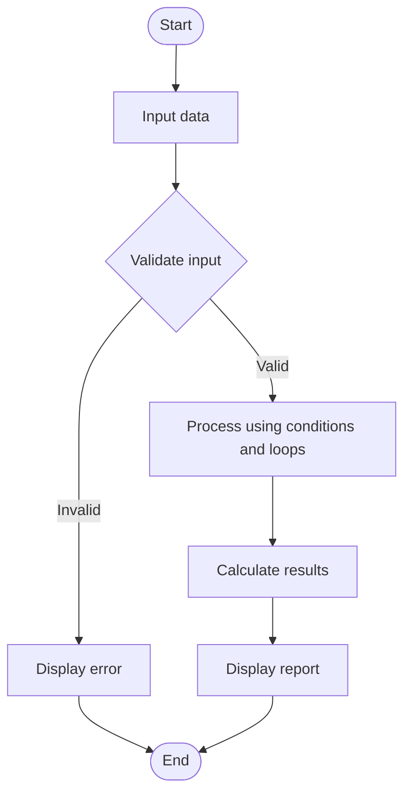

# Case Study 2: Progressive Electricity Billing

## 1. Problem Statement
Calculate a household electricity bill using consumption slabs, a fixed charge, surcharge, and rebate, then compare monthly bills.

## 2. Objectives
- Calculate slab-wise energy charges.
- Apply fixed charge, surcharge, and rebate.
- Compare two monthly bills.

## 3. Assumptions
- First 100 units cost ₹2 per unit.
- Next 100 units cost ₹3 per unit.
- Units above 200 cost ₹5 per unit.
- Fixed charge is ₹50; surcharge is 5% of energy charge; rebate is ₹20 if consumption is at most 100 units.

## 4. Algorithm
1. Start.
2. Input units for two months.
3. Reject negative units.
4. Calculate energy charge by slabs for each month.
5. Add fixed charge and surcharge, then subtract applicable rebate.
6. Display both bills and compare them.
7. Stop.

## 5. Flowchart
The flowchart below shows the general flow of this program. The validation and processing boxes correspond to the specific steps in the algorithm.



## 6. Pseudocode
```text
START
INPUT units for Month 1 and Month 2
FOR each month:
  IF units <= 100: energy = units * 2
  ELSE IF units <= 200: energy = 100*2 + (units-100)*3
  ELSE: energy = 100*2 + 100*3 + (units-200)*5
  surcharge = energy * 0.05
  bill = energy + 50 + surcharge
  IF units <= 100: bill = bill - 20
DISPLAY both bills and their difference
STOP
```

## 7. Python Source Code
The complete runnable program is saved in [`program.py`](program.py).

```python
def calculate_bill(units):
    if units < 0:
        return -1
    if units <= 100:
        energy = units * 2
    elif units <= 200:
        energy = 100 * 2 + (units - 100) * 3
    else:
        energy = 100 * 2 + 100 * 3 + (units - 200) * 5

    surcharge = energy * 0.05
    bill = energy + 50 + surcharge
    if units <= 100:
        bill -= 20
    return bill

month1 = int(input("Enter units used in Month 1: "))
month2 = int(input("Enter units used in Month 2: "))

bill1 = calculate_bill(month1)
bill2 = calculate_bill(month2)

if bill1 < 0 or bill2 < 0:
    print("Invalid units. Units cannot be negative.")
else:
    print("Month 1 bill: Rs.", round(bill1, 2))
    print("Month 2 bill: Rs.", round(bill2, 2))
    difference = bill2 - bill1
    print("Bill difference: Rs.", round(abs(difference), 2))
    if difference > 0:
        print("Bill increased in Month 2.")
    elif difference < 0:
        print("Bill decreased in Month 2.")
    else:
        print("Both bills are equal.")
```

## 8. Test Cases
- **Input:** Month 1 = 80, Month 2 = 150
  **Expected result:** Month 1 bill = ₹198.00; Month 2 bill = ₹417.50; bill increased by ₹219.50

**Note:** Run the program with the test inputs above and capture the actual console output for the submission screenshots.

## 9. Output Screenshot
Add a screenshot of the program running here after executing `program.py`.

Suggested filename: `output.png`

## 10. Conclusion
The program applies progressive electricity tariffs and compares two monthly bills.

