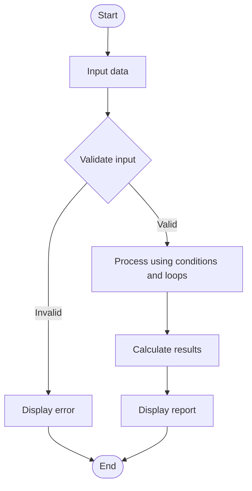

# Case Study 7: Retail Billing with Multiple Discount Rules

## 1. Problem Statement
Create an itemized retail invoice with quantities, category-specific tax, a threshold discount, and a maximum discount limit.

## 2. Objectives
- Calculate each item's subtotal.
- Apply a threshold discount and cap it.
- Calculate tax and final invoice.

## 3. Assumptions
- Three sample products are entered by the user.
- Electronics tax is 10%; other items tax is 5%.
- A 10% discount applies when subtotal is at least ₹2000.
- Discount is capped at ₹500; tax is calculated after discount.

## 4. Algorithm
1. Start.
2. Input three product names, category, price, and quantity.
3. Validate non-negative price and quantity.
4. Calculate subtotal.
5. Apply 10% discount if subtotal is at least ₹2000, capped at ₹500.
6. Calculate tax on discounted subtotal based on category rates per item.
7. Display invoice and final amount.
8. Stop.

## 5. Flowchart
The flowchart below shows the general flow of this program. The validation and processing boxes correspond to the specific steps in the algorithm.



## 6. Pseudocode
```text
START
subtotal = 0
REPEAT 3 times: INPUT name, category, price, quantity
  subtotal = subtotal + price * quantity
IF subtotal >= 2000: discount = minimum(subtotal*0.10, 500)
ELSE discount = 0
discounted_total = subtotal - discount
CALCULATE tax for each item using its category rate
final = discounted_total + total tax
DISPLAY itemized invoice and final
STOP
```

## 7. Python Source Code
The complete runnable program is saved in [`program.py`](program.py).

```python
items = []
subtotal = 0
tax_total = 0

for i in range(3):
    print("\nProduct", i + 1)
    name = input("Product name: ")
    category = input("Category (electronics/other): ").lower()
    price = float(input("Price: Rs. "))
    quantity = int(input("Quantity: "))
    if price < 0 or quantity < 0:
        print("Invalid price or quantity.")
        raise SystemExit
    items.append((name, category, price, quantity))
    subtotal += price * quantity

if subtotal >= 2000:
    discount = min(subtotal * 0.10, 500)
else:
    discount = 0

discount_ratio = discount / subtotal if subtotal > 0 else 0
print("\nITEMIZED INVOICE")
for name, category, price, quantity in items:
    item_total = price * quantity
    item_discount = item_total * discount_ratio
    taxable = item_total - item_discount
    rate = 0.10 if category == "electronics" else 0.05
    tax = taxable * rate
    tax_total += tax
    print(name, "| Qty:", quantity, "| Subtotal:", round(item_total, 2),
          "| Tax:", round(tax, 2))

print("Subtotal: Rs.", round(subtotal, 2))
print("Discount: Rs.", round(discount, 2))
print("Tax total: Rs.", round(tax_total, 2))
print("Final bill: Rs.", round(subtotal - discount + tax_total, 2))
```

## 8. Test Cases
- **Input:** Product A electronics ₹1000 x 1; Product B other ₹500 x 2; Product C other ₹100 x 1
  **Expected result:** Subtotal ₹2100; discount ₹210; tax depends on item category after proportional discount; final bill displayed by program.

**Note:** Run the program with the test inputs above and capture the actual console output for the submission screenshots.

## 9. Output Screenshot
Add a screenshot of the program running here after executing `program.py`.

Suggested filename: `output.png`

## 10. Conclusion
The program generates an itemized bill and applies discount and tax rules.

