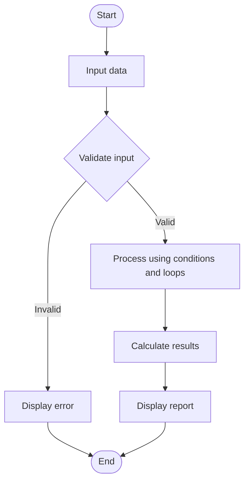

# Case Study 12: Attendance Recovery Computation

## 1. Problem Statement
Calculate current attendance percentage and determine the minimum consecutive classes a student must attend to reach the required attendance threshold.

## 2. Objectives
- Calculate attendance percentage.
- Find the minimum classes needed to reach the threshold.
- Handle invalid attendance counts.

## 3. Assumptions
- The required attendance threshold is 75%.
- Future classes are all attended.
- Classes attended cannot exceed classes conducted.

## 4. Algorithm
1. Start.
2. Input attended and conducted classes.
3. Validate counts.
4. Calculate current percentage.
5. If percentage is sufficient, display zero required classes.
6. Otherwise, use a loop to find the smallest number of future attended classes that reaches 75%.
7. Display result and stop.

## 5. Flowchart
The flowchart below shows the general flow of this program. The validation and processing boxes correspond to the specific steps in the algorithm.



## 6. Pseudocode
```text
START
INPUT attended, conducted
IF attended < 0 OR conducted <= 0 OR attended > conducted: DISPLAY invalid; STOP
percentage = attended / conducted * 100
future = 0
WHILE (attended + future)/(conducted + future)*100 < 75:
  future = future + 1
DISPLAY percentage and future
STOP
```

## 7. Python Source Code
The complete runnable program is saved in [`program.py`](program.py).

```python
attended = int(input("Classes attended: "))
conducted = int(input("Total classes conducted: "))
threshold = 75

if conducted <= 0 or attended < 0 or attended > conducted:
    print("Invalid attendance details.")
else:
    percentage = attended / conducted * 100
    print("Current attendance:", round(percentage, 2), "%")

    future = 0
    while (attended + future) / (conducted + future) * 100 < threshold:
        future += 1

    if future == 0:
        print("You already meet the attendance requirement.")
    else:
        print("Minimum consecutive classes to attend:", future)
        print("Attendance after attending them:",
              round((attended + future) / (conducted + future) * 100, 2), "%")
```

## 8. Test Cases
- **Input:** Attended = 60, conducted = 100
  **Expected result:** Current attendance = 60.0%; minimum future classes = 60; resulting attendance = 75.0%.

**Note:** Run the program with the test inputs above and capture the actual console output for the submission screenshots.

## 9. Output Screenshot
Add a screenshot of the program running here after executing `program.py`.

Suggested filename: `output.png`

## 10. Conclusion
The program computes attendance and uses a loop to find the minimum classes needed to reach the threshold.

