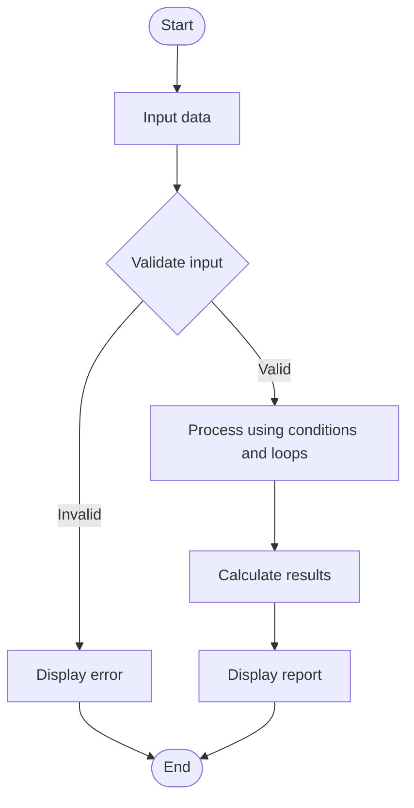

# Case Study 42: Student Marks Matrix Analysis

## 1. Problem Statement
Analyse a nested list of marks to calculate student totals and averages, subject averages, top performer, and low-performing subjects.

## 2. Objectives
- Represent marks in a nested list.
- Calculate row-wise and column-wise averages.
- Identify top student and subjects with low averages.

## 3. Assumptions
- Three students and three subjects are used for a simple demonstration.
- Marks are between 0 and 100.
- A subject average below 40 is considered low.

## 4. Algorithm
1. Start.
2. Input student names and marks for three subjects.
3. Validate each mark.
4. Calculate each student's total and average.
5. Calculate each subject's average.
6. Find the top student and subjects below average threshold.
7. Display report and stop.

## 5. Flowchart
The flowchart below shows the general flow of this program. The validation and processing boxes correspond to the specific steps in the algorithm.



## 6. Pseudocode
```text
START
INPUT 3 student names and 3 marks per student
FOR each student row: calculate total and average
FOR each subject column: calculate average
top_index = index of highest student total
DISPLAY each student's total and average
DISPLAY top student and low-average subjects
STOP
```

## 7. Python Source Code
The complete runnable program is saved in [`program.py`](program.py).

```python
students = []
marks = []
subjects = ["Python", "Maths", "English"]

for i in range(3):
    name = input("Enter student name: ")
    row = []
    for subject in subjects:
        mark = float(input("Enter " + subject + " mark for " + name + ": "))
        if mark < 0 or mark > 100:
            print("Marks must be between 0 and 100.")
            raise SystemExit
        row.append(mark)
    students.append(name)
    marks.append(row)

totals = []
print("\nSTUDENT REPORT")
for i in range(len(students)):
    total = sum(marks[i])
    average = total / len(subjects)
    totals.append(total)
    print(students[i], "Total:", total, "Average:", round(average, 2))

print("\nSUBJECT AVERAGES")
low_subjects = []
for j in range(len(subjects)):
    total = 0
    for i in range(len(students)):
        total += marks[i][j]
    average = total / len(students)
    print(subjects[j], "average:", round(average, 2))
    if average < 40:
        low_subjects.append(subjects[j])

top_index = totals.index(max(totals))
print("Top performer:", students[top_index])
print("Low-average subjects:", low_subjects if low_subjects else "None")
```

## 8. Test Cases
- **Input:** A: 80,70,90; B: 60,65,70; C: 30,35,40
  **Expected result:** Totals: A=240, B=195, C=105; top performer A; subject averages Python=56.67, Maths=56.67, English=66.67; no subject average below 40.

**Note:** Run the program with the test inputs above and capture the actual console output for the submission screenshots.

## 9. Output Screenshot
Add a screenshot of the program running here after executing `program.py`.

Suggested filename: `output.png`

## 10. Conclusion
The program demonstrates nested-list processing and row-wise and column-wise mark analysis.

