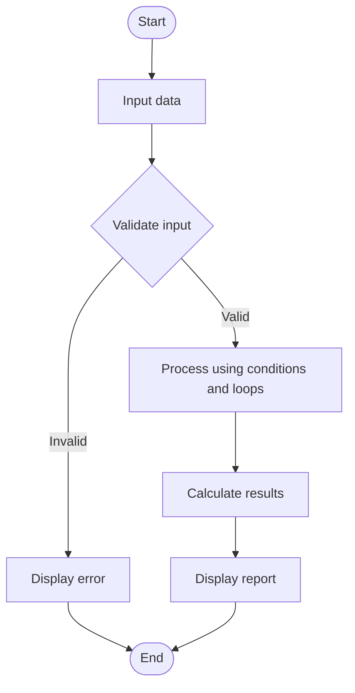

# Case Study 38: ATM Menu-Driven Banking Simulation

## 1. Problem Statement
Simulate ATM deposits, withdrawals, balance inquiries, and transaction summaries with basic validation and account limits.

## 2. Objectives
- Create a repeated menu.
- Update balance after valid transactions.
- Keep a transaction history and reject invalid operations.

## 3. Assumptions
- Starting balance is ₹5000.
- Maximum single withdrawal is ₹20000.
- Withdrawals cannot exceed balance.
- This is a learning simulation, not a real banking system.

## 4. Algorithm
1. Start with balance ₹5000 and empty transaction list.
2. Display menu repeatedly.
3. Read user choice.
4. Perform deposit, withdrawal, balance inquiry, or transaction summary.
5. Reject invalid amounts and withdrawals beyond balance or limit.
6. Exit when user chooses 5.
7. Stop.

## 5. Flowchart
The flowchart below shows the general flow of this program. The validation and processing boxes correspond to the specific steps in the algorithm.



## 6. Pseudocode
```text
START
balance = 5000; transactions = empty list
REPEAT
  DISPLAY menu
  INPUT choice
  IF choice = 1: INPUT amount; if positive add to balance and history
  ELSE IF choice = 2: INPUT amount; validate amount, balance, and limit
  ELSE IF choice = 3: DISPLAY balance
  ELSE IF choice = 4: DISPLAY transactions
  ELSE IF choice = 5: EXIT LOOP
  ELSE: DISPLAY invalid choice
UNTIL exit
STOP
```

## 7. Python Source Code
The complete runnable program is saved in [`program.py`](program.py).

```python
balance = 5000.0
transactions = []

while True:
    print("\nATM MENU")
    print("1. Deposit")
    print("2. Withdraw")
    print("3. Check balance")
    print("4. Transaction summary")
    print("5. Exit")
    choice = input("Choose an option: ")

    if choice == "1":
        amount = float(input("Deposit amount: Rs. "))
        if amount > 0:
            balance += amount
            transactions.append(("Deposit", amount))
            print("Deposit successful.")
        else:
            print("Amount must be positive.")
    elif choice == "2":
        amount = float(input("Withdrawal amount: Rs. "))
        if amount <= 0:
            print("Amount must be positive.")
        elif amount > 20000:
            print("Withdrawal exceeds the single-transaction limit.")
        elif amount > balance:
            print("Insufficient balance.")
        else:
            balance -= amount
            transactions.append(("Withdrawal", amount))
            print("Withdrawal successful.")
    elif choice == "3":
        print("Current balance: Rs.", round(balance, 2))
    elif choice == "4":
        print("TRANSACTION SUMMARY")
        if not transactions:
            print("No transactions yet.")
        for kind, amount in transactions:
            print(kind, ": Rs.", amount)
        print("Current balance: Rs.", round(balance, 2))
    elif choice == "5":
        print("Thank you for using the ATM simulation.")
        break
    else:
        print("Invalid option. Choose 1 to 5.")
```

## 8. Test Cases
- **Input:** Deposit ₹1000, withdraw ₹500, check balance
  **Expected result:** Starting balance ₹5000; after deposit ₹6000; after withdrawal ₹5500.

**Note:** Run the program with the test inputs above and capture the actual console output for the submission screenshots.

## 9. Output Screenshot
Add a screenshot of the program running here after executing `program.py`.

Suggested filename: `output.png`

## 10. Conclusion
The program simulates common ATM operations and records valid transactions.

