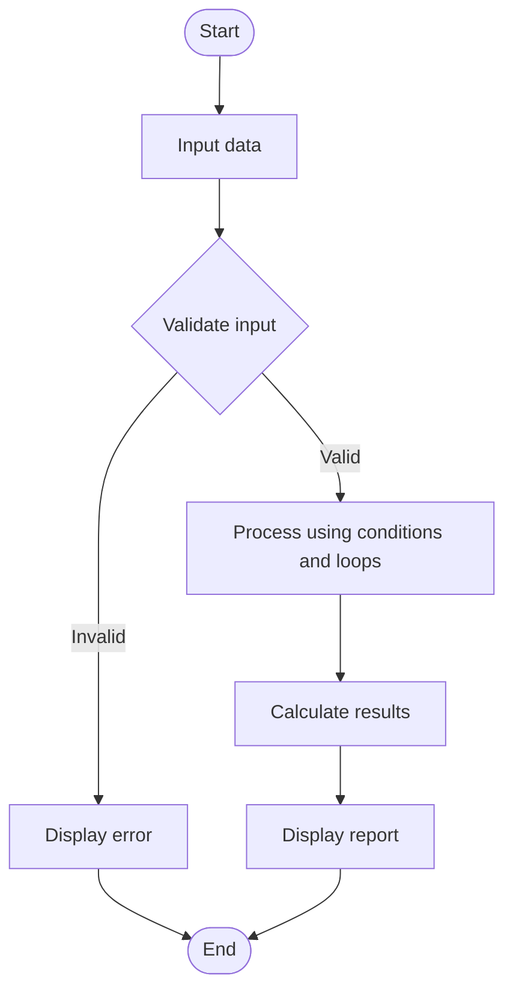

# Case Study 14: Warehouse Inventory Reconciliation

## 1. Problem Statement
Compare opening stock, incoming quantities, dispatched quantities, and actual closing stock for multiple products to detect discrepancies and replenishment needs.

## 2. Objectives
- Calculate expected closing stock.
- Compare expected and actual stock.
- Report discrepancies and replenishment requirements.

## 3. Assumptions
- Three products are entered.
- Stock quantities must be non-negative integers.
- Target stock levels are supplied by the user.

## 4. Algorithm
1. Start.
2. Input product name, opening stock, incoming, dispatched, actual closing, and target stock for each product.
3. Validate all quantities.
4. Calculate expected closing stock = opening + incoming - dispatched.
5. Compare expected with actual stock.
6. Calculate replenishment needed to reach target stock.
7. Display reconciliation report and stop.

## 5. Flowchart
The flowchart below shows the general flow of this program. The validation and processing boxes correspond to the specific steps in the algorithm.



## 6. Pseudocode
```text
START
FOR 3 products: INPUT name, opening, incoming, dispatched, actual, target
  expected = opening + incoming - dispatched
  discrepancy = actual - expected
  replenishment = maximum(0, target - actual)
  DISPLAY expected, discrepancy, replenishment
STOP
```

## 7. Python Source Code
The complete runnable program is saved in [`program.py`](program.py).

```python
products = []

for i in range(3):
    print("\nProduct", i + 1)
    name = input("Product name: ")
    opening = int(input("Opening stock: "))
    incoming = int(input("Incoming quantity: "))
    dispatched = int(input("Dispatched quantity: "))
    actual = int(input("Actual closing stock: "))
    target = int(input("Target stock level: "))

    if min(opening, incoming, dispatched, actual, target) < 0:
        print("Stock values cannot be negative.")
        raise SystemExit
    if dispatched > opening + incoming:
        print("Warning: dispatched quantity exceeds available stock.")

    products.append((name, opening, incoming, dispatched, actual, target))

print("\nINVENTORY RECONCILIATION")
for name, opening, incoming, dispatched, actual, target in products:
    expected = opening + incoming - dispatched
    discrepancy = actual - expected
    replenishment = max(0, target - actual)
    print("\nProduct:", name)
    print("Expected closing stock:", expected)
    print("Actual closing stock:", actual)
    print("Discrepancy (actual - expected):", discrepancy)
    print("Replenishment required:", replenishment)
```

## 8. Test Cases
- **Input:** Opening 50, incoming 20, dispatched 30, actual 38, target 60
  **Expected result:** Expected closing = 40; discrepancy = -2; replenishment = 22.

**Note:** Run the program with the test inputs above and capture the actual console output for the submission screenshots.

## 9. Output Screenshot
Add a screenshot of the program running here after executing `program.py`.

Suggested filename: `output.png`

## 10. Conclusion
The program checks inventory consistency and calculates the quantity required to replenish stock.

