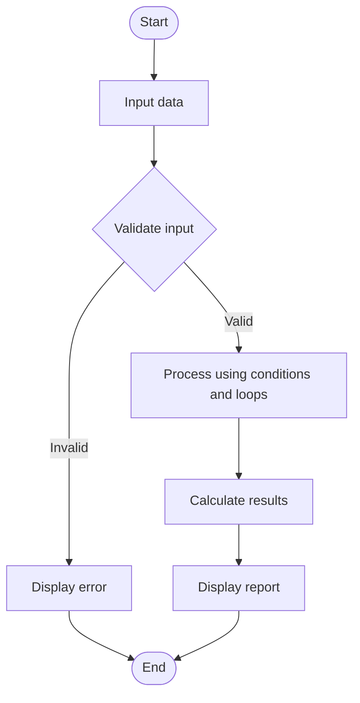

# Case Study 1: University Scholarship Allocation

## 1. Problem Statement
Evaluate scholarship applicants based on aggregate marks, minimum subject marks, attendance, and family income, then rank eligible applicants.

## 2. Objectives
- Check all scholarship eligibility criteria.
- Identify eligible students.
- Rank eligible applicants by marks, then attendance.

## 3. Assumptions
- Three applicants are entered.
- Eligibility requires average marks at least 75, each subject at least 60, attendance at least 75%, and annual income no more than ₹300000.
- Ties are resolved by higher attendance.

## 4. Algorithm
1. Start.
2. Input applicant name, three subject marks, attendance, and annual family income.
3. Validate values.
4. Check all eligibility criteria.
5. Store eligible applicants with average and attendance.
6. Sort by average descending, then attendance descending.
7. Display eligible ranking and rejected applicants.
8. Stop.

## 5. Flowchart
The flowchart below shows the general flow of this program. The validation and processing boxes correspond to the specific steps in the algorithm.



## 6. Pseudocode
```text
START
eligible = empty list
FOR each of 3 applicants: INPUT name, marks, attendance, income
  average = sum(marks)/3
  IF average >= 75 AND every mark >= 60 AND attendance >= 75 AND income <= 300000:
    ADD applicant to eligible list
  ELSE: DISPLAY applicant not eligible
SORT eligible by average descending, attendance descending
DISPLAY ranking
STOP
```

## 7. Python Source Code
The complete runnable program is saved in [`program.py`](program.py).

```python
eligible = []

for i in range(3):
    print("\nApplicant", i + 1)
    name = input("Name: ")
    marks = []
    for subject in ["Subject 1", "Subject 2", "Subject 3"]:
        mark = float(input(subject + " mark: "))
        if mark < 0 or mark > 100:
            print("Marks must be from 0 to 100.")
            raise SystemExit
        marks.append(mark)
    attendance = float(input("Attendance percentage: "))
    income = float(input("Annual family income (Rs.): "))

    if attendance < 0 or attendance > 100 or income < 0:
        print("Invalid attendance or income.")
        raise SystemExit

    average = sum(marks) / len(marks)
    if average >= 75 and min(marks) >= 60 and attendance >= 75 and income <= 300000:
        eligible.append((name, average, attendance))
        print(name, "is eligible.")
    else:
        print(name, "is not eligible.")

eligible.sort(key=lambda applicant: (applicant[1], applicant[2]), reverse=True)

print("\nSCHOLARSHIP RANKING")
if not eligible:
    print("No eligible applicants.")
else:
    for rank, applicant in enumerate(eligible, start=1):
        name, average, attendance = applicant
        print(rank, name, "| Average:", round(average, 2),
              "| Attendance:", attendance, "%")
```

## 8. Test Cases
- **Input:** Applicant A marks 80,85,90; attendance 90%; income ₹250000
  **Expected result:** Applicant A meets all criteria and is included in ranking if entered among the applicants.

**Note:** Run the program with the test inputs above and capture the actual console output for the submission screenshots.

## 9. Output Screenshot
Add a screenshot of the program running here after executing `program.py`.

Suggested filename: `output.png`

## 10. Conclusion
The program applies scholarship criteria consistently and ranks qualified applicants.

