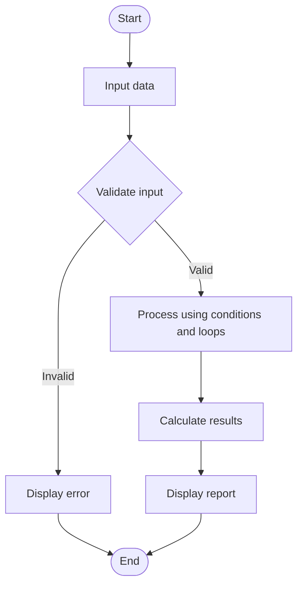

# Case Study 26: Nested Loop Examination Seating Generator

## 1. Problem Statement
Generate a classroom seating arrangement using row and column positions, reserved seats, and alternate seating restrictions.

## 2. Objectives
- Create a seating grid with nested lists.
- Mark reserved seats.
- Place students in allowed positions and report remaining seats.

## 3. Assumptions
- The classroom has 4 rows and 4 columns.
- Seat R1C1 and R2C2 are reserved.
- Students are seated in alternate checkerboard positions where row index plus column index is even, excluding reserved seats.

## 4. Algorithm
1. Start.
2. Create a 4 by 4 seating matrix.
3. Mark reserved positions.
4. Read student names.
5. Traverse the matrix with nested loops and fill permitted empty seats.
6. Display the seating grid and unseated students.
7. Stop.

## 5. Flowchart
The flowchart below shows the general flow of this program. The validation and processing boxes correspond to the specific steps in the algorithm.



## 6. Pseudocode
```text
START
rows = 4; columns = 4
CREATE empty seating matrix
MARK R1C1 and R2C2 as RESERVED
INPUT student names separated by commas
FOR each row and column:
  IF position is reserved: keep RESERVED
  ELSE IF (row + column) is even AND students remain: assign next student
  ELSE: mark EMPTY
DISPLAY matrix and unseated students
STOP
```

## 7. Python Source Code
The complete runnable program is saved in [`program.py`](program.py).

```python
rows = 4
columns = 4
reserved = [(0, 0), (1, 1)]
seats = [["EMPTY" for c in range(columns)] for r in range(rows)]

for r, c in reserved:
    seats[r][c] = "RESERVED"

names_text = input("Enter student names separated by commas: ")
students = names_text.split(",")
for i in range(len(students)):
    students[i] = students[i].strip()

student_index = 0
for r in range(rows):
    for c in range(columns):
        if (r, c) not in reserved and (r + c) % 2 == 0 and student_index < len(students):
            seats[r][c] = students[student_index]
            student_index += 1

print("\nSEATING ARRANGEMENT")
for r in range(rows):
    row_display = []
    for c in range(columns):
        row_display.append(seats[r][c])
    print("Row", r + 1, ":", " | ".join(row_display))

if student_index < len(students):
    print("Unseated students:", students[student_index:])
else:
    print("All students seated where permitted.")
```

## 8. Test Cases
- **Input:** Names: Asha, Ravi, Kiran, Meena, John
  **Expected result:** Students are placed in permitted non-reserved alternate seats; any remaining names are listed as unseated.

**Note:** Run the program with the test inputs above and capture the actual console output for the submission screenshots.

## 9. Output Screenshot
Add a screenshot of the program running here after executing `program.py`.

Suggested filename: `output.png`

## 10. Conclusion
The program uses nested loops and a nested list to generate a seating plan while respecting reserved and alternate positions.

